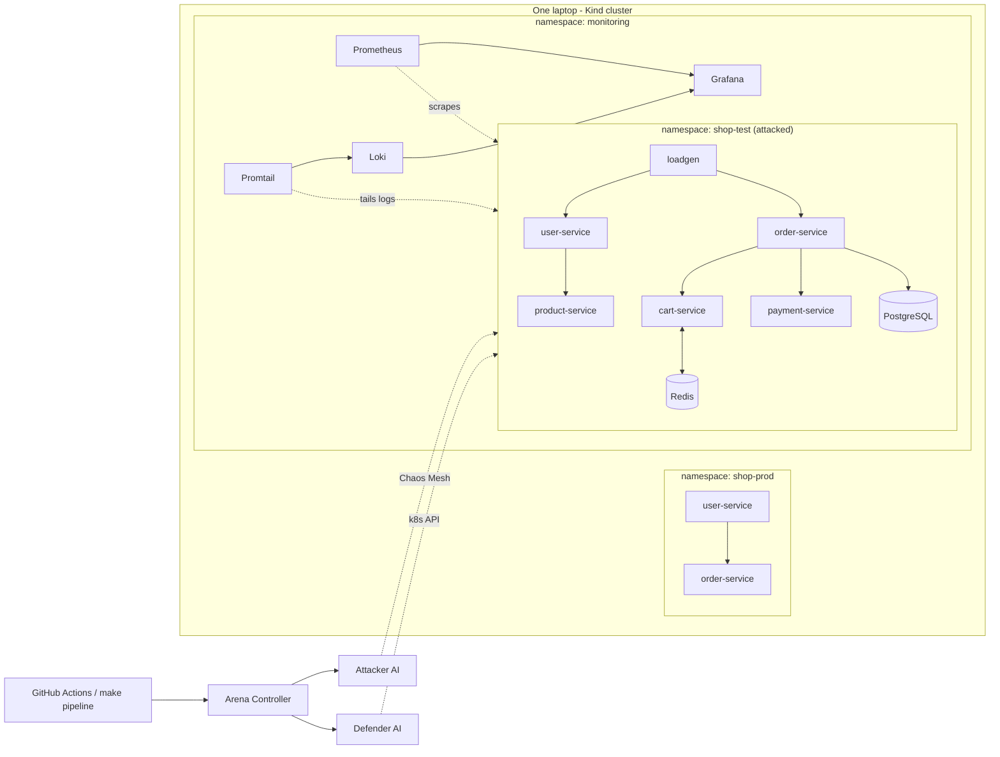

# ChaosArena

[](https://github.com/atharvvv10/chaosarena/actions/workflows/ci.yml)

A resilience-gated CI/CD platform where an Attacker AI and a Defender AI battle on a
local Kubernetes cluster. A release is promoted only if it survives the attack and
scores above a configurable threshold.

> **Current status: Phase 8 complete** — ShopApp, observability, 7 attacks, Defender, release gate, LLM incident reporter, free GitHub Actions, local React dashboard and a free tabular RL attacker.

## Architecture (Mermaid)



## Why this design

- **5 small FastAPI services** keep the demo believable while staying light on a laptop.
- **One shared observability module** gives every service identical logs and metrics,
  which is exactly what an anomaly detector needs.
- **Kustomize overlays** let `shop-test` and `shop-prod` share one set of manifests but
  carry different `VERSION` values, so a rollback is just a config change.
- **Prometheus + Loki** cover both numeric signals and logs, which the Defender will
  later use independently (it is never allowed to read the Attacker's plan).

## Phase checklist

- [x] **Phase 1** — ShopApp + loadgen + Prometheus/Grafana/Loki
- [x] **Phase 2** — Chaos Mesh + 7 allowlisted attacks + guaranteed cleanup
- [x] **Phase 3** — Isolation Forest Defender detect/diagnose/act/verify
- [x] **Phase 4** — Arena Controller, Resilience Score, `/gate/evaluate`
- [x] **Phase 5** — LLM incident reporter (offline default, free Groq optional)
- [x] **Phase 6** — GitHub Actions resilience gate (free tier, no secrets)
- [x] **Phase 7** — React dashboard (local, free, no UI kit)
- [x] **Phase 8** — RL Attacker (sim + real, standard library only)
- [ ] Phase 9 — docs, results, tests, polish

## Quickstart — Kubernetes (recommended)

Prerequisites: WSL2 Ubuntu 22.04, Docker Desktop (WSL2 integration), kubectl v1.30+,
Kind v0.23+, make. See the prerequisite table in the phase 1 build notes.

```bash
cd chaosarena
make cluster     # creates the 'chaosarena' Kind cluster and 3 namespaces
make deploy      # builds 6 images, loads them, applies all manifests
make status      # all pods should be Running/Ready
make dashboard   # in another terminal: Grafana on http://localhost:3000 (admin/admin)
```

## Quickstart — Docker Compose (no Kubernetes)

```bash
cd chaosarena
make dev-up      # Grafana http://localhost:3000, Prometheus http://localhost:9090
make dev-down
```

## Quickstart — plain Python (no Docker at all)

```bash
cd chaosarena
python -m venv .venv
.venv\Scripts\pip install -r requirements-dev.txt     # Windows
python scripts/run_local.py                           # starts all 5 services + loadgen
```

This uses `fakeredis` over TCP and the sqlite fallback in `common/db.py`.
Production images still use real Redis and PostgreSQL.

## Local setup on this machine

See [docs/local-setup.md](docs/local-setup.md) — installed tool versions and WSL2 setup.
See [docs/phase2.md](docs/phase2.md) — the 7 attacks, hard allowlist, cleanup design and
measured results. Chaos Mesh is installed in the `chaos-mesh` namespace.
See [docs/phase3.md](docs/phase3.md) — the Defender's model, bounded actions and
the full detect → diagnose → act → verify result.
See [docs/phase4.md](docs/phase4.md) — the battle, score rules, gate decision and API.
See [docs/phase5.md](docs/phase5.md) — the incident report, offline backend and free Groq setup.
See [docs/phase6.md](docs/phase6.md) — the free GitHub Actions workflow and CI gate.
See [docs/phase7.md](docs/phase7.md) — the React dashboard, API additions and browser verification.
See [dashboard/README.md](dashboard/README.md) — how to run the UI next to the gate API.
See [docs/phase8.md](docs/phase8.md) — the free Q-learning attacker, simulator and real battle.

## Verify Phase 1

```bash
make smoke
kubectl -n shop-test get pods
kubectl -n monitoring logs deploy/promtail --tail=20
```

In Grafana, open **Dashboards → ShopApp → ChaosArena - ShopApp Live**. You should see
non-zero lines for all five services in the request-rate, error-rate and latency panels.

## Build verification actually performed

- `pytest` → **77 passed** (Phase 1: services and metrics; Phase 2: allowlist,
  all 7 manifests, cleanup; Phase 3: model, diagnosis, bounded actions;
  Phase 4: score, gate, audit log, API; Phase 5: facts, prompt, report, offline + free Groq;
  Phase 6: workflow, gate self-test, recomputed verdict).
- All five services + loadgen launched via `scripts/run_local.py` on a machine with
  **no Docker, no WSL2, no kubectl and no make**.
- Live end-to-end flow succeeded: register → JWT login → catalogue → cart add →
  payment → order create → order read. Example order: `total 13.5`, `status paid`,
  `version v1.0.0`.
- Live `/metrics` emitted `http_requests_total` and the latency histogram with
  counts incrementing after real HTTP calls.
- After WSL2 was activated, the full Kubernetes path was executed for real:
  Docker Desktop engine 29.9.3, Kind cluster `chaosarena` (1 control-plane node),
  6 images built and loaded, and all manifests applied to `shop-test`, `shop-prod`
  and `monitoring`.
- Prometheus scrapes **22 healthy pod targets** with non-zero request-rate and
  latency data; Grafana 11.2.0 serves the 6-panel `ChaosArena - ShopApp Live`
  dashboard; Loki receives structured logs via Promtail with `namespace`, `pod`
  and `container` labels.
- In-cluster end-to-end order: `total 13.5`, `status paid`, read back successfully
  through a port-forward to `order-service`.
- Phase 2: Chaos Mesh 2.8.8 installed; all 7 manifests passed server-side dry-run;
  `pod-failure` cleaned up with zero remaining objects; `network-latency` moved
  order-service p95 from **0.24 s → 0.845 s → 0.24 s** (before / during / after).
- Phase 3: 40-sample baseline trained to threshold **0.7397**. During a real
  latency attack the Defender scored **1.123**, diagnosed `latency_spike` on
  `order-service` (`z=+237.6`), restarted it in `shop-test`, and verification
  returned **0.586** with `recovered: true`. No attacker import in `defender/`.
- Phase 4: a real battle was blocked first (score 65) and promoted after the
  settle fix (score 100, `PROMOTE` for `v1.0.1`). `/gate/evaluate` also ran a
  `pod-kill` battle live through uvicorn; decisions are in
  `ml/gate_decisions.jsonl`. No attacker/defender import in `controller/`.
- Phase 5: a fresh 20-second battle produced `ml/last_battle.json`; the offline
  reporter wrote a six-section `ml/incident_report.md` using only recorded facts.
  Groq's **free** tier is wired in (`openai/gpt-oss-20b`) for a real-model report
  with only `GROQ_API_KEY`. A real free-tier Groq call wrote
  `ml/incident_report_groq.md` with all six sections and the correct battle facts.
- Phase 6: `.github/workflows/ci.yml` runs tests and the resilience gate on
  GitHub's free `ubuntu-latest` runner. The passing fixture scores 100/`PROMOTE`,
  the bad fixture scores 0/`BLOCK`, and a tampered stored decision is ignored.
  No cluster, secrets, cloud or paid action is required.

Note: `infra/k8s/observability/promtail.yaml` uses a static `__path__` tail plus
pipeline stages. This is intentional for the single-node Kind cluster — it avoids
Kubernetes service-discovery edge cases and was verified with real log entries.

## Screenshots (placeholders)

- `docs/screenshots/phase1-grafana.png`
- `docs/screenshots/phase1-pods.png`

## Repository layout

```
chaosarena/
  services/       user, product, cart, order, payment, loadgen + shared common/
  attacker/       Phase 2+
  defender/       Phase 3+
  controller/     Phase 4+
  reporter/       Phase 5+
  ci/             Phase 6+ (fixtures + gate checker)
  dashboard/      Phase 7+
  infra/          kind config, k8s manifests, grafana provisioning, compose configs
  ml/             Phase 3+
  .github/        Phase 6+
  docs/           Phase 9+
```
