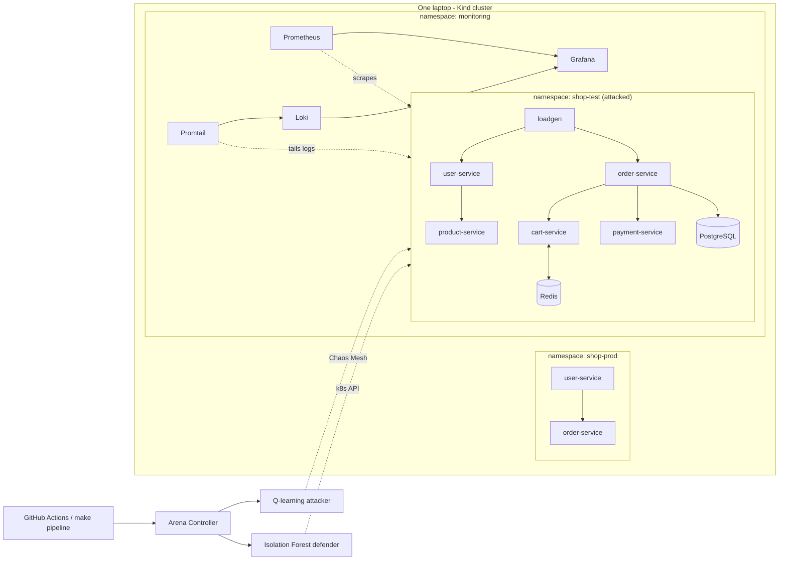

# ChaosArena

[](https://github.com/atharvvv10/chaosarena/actions/workflows/ci.yml)

**A resilience-gated CI/CD lab that treats a release like a fight.** A tabular Q-learning attacker injects one of seven allowlisted Chaos Mesh faults into a `shop-test` namespace; an Isolation Forest defender detects, diagnoses and repairs the fault; and a controller scores the whole exchange into a `PROMOTE`/`BLOCK` decision. It all runs on one laptop with Kind, Prometheus, Grafana and a React dashboard — no cloud account, paid CI minute, hosted database or API key. The repo ships the tests, saved battle evidence, free GitHub Actions workflow and a recorded demo, so you can see and verify the full loop rather than trust a diagram.


[Watch the full demo (MP4)](docs/screenshots/demo.mp4) · [Dashboard screenshot](docs/screenshots/dashboard.png) · [Grafana screenshot](docs/screenshots/grafana.png) · [All results](docs/RESULTS.md)

The GIF and MP4 record the detected 100/A battle on the current dashboard; the PNG is a full-page capture of the same UI.

## Results at a glance

| What | Measured result |
| --- | --- |
| Automated tests | **120 passing** across all 9 phases (`make verify`) |
| Chaos attacks | **7** allowlisted faults, `shop-test` only, guaranteed cleanup — **0 objects left** |
| Headline gated battle | **100/100, grade A, PROMOTE** at threshold 70; `network-latency` detected in **0.0 s (first poll)**, recovered in **57.4 s**, cleanup ok, 0 objects left |
| Defender | Detected in **13.8 s**, recovered in **61.6 s**; diagnosed `latency_spike` → restarted `order-service`; 40-sample baseline (threshold 0.7397) |
| RL attacker | Learned policy does **more damage than random**: **1.77×** (resilience **70.0** vs **83.1**) in the seeded simulator |
| Detector comparison | Plain Isolation Forest **0% recall**; full Defender **76% recall at 0% false positives** — [details](#detector-comparison) |
| CI | Free `ubuntu-latest` Actions, green on every push, no cluster, no secrets |
| Cost | **$0** — local Kind, free React/Vite, free Actions tier, offline reporter by default |

## Learned vs random attacker

A Q-table is only useful if it finds worse attacks than chance. In the seeded
offline simulator (200 episodes, seed 7, per-fault effectiveness taken from
recorded Phase 3/4 battles):

| Policy | Avg damage (0–100) | Avg resilience score |
| --- | --- | --- |
| Uniform random | 16.9 | 83.1 |
| **Learned Q-learning** | **30.0** | **70.0** |

The learned attacker converges on `network-partition@payment-service` and does
**more damage than random** — 1.77× as much, measured as points taken off the
resilience score. This is a reproducible offline benchmark, **not** a live
cluster battle. Evidence: `ml/rl_benchmark.json`; regenerate with
`python -m rl.cli benchmark`.

## Detector comparison

Same labelled data for all three: the committed 40-sample normal baseline plus
160 seeded fault signatures (latency spike, error spike, traffic drop, and a
subtle multi-service latency rise). Offline and reproducible — evidence in
`ml/defender_benchmark.json`; regenerate with `python -m defender.cli benchmark`.

| Detector | Precision | Recall | False positives |
| --- | --- | --- | --- |
| Rule-based (3-sigma) | 99.4% | **100%** | 1 / 40 normal |
| Isolation Forest only | n/a | 0% | 0 / 40 normal |
| **Defender (forest + capped deviation)** | **100%** | 76.2% | **0 / 40 normal** |

Read this honestly: a simple 3-sigma rule catches every seeded spike but raises
a false alarm on normal traffic. A plain Isolation Forest catches **none** —
across 18 features it dilutes a single-service spike until it looks normal. The
shipped Defender adds a bounded standardized-deviation term that lifts recall
from 0% to 76% while keeping **zero false positives**; the remaining misses are
small error-rate spikes. Zero false positives is the right trade for a release
gate, where a false alarm blocks a good build.

## What is in the loop

1. **Attacker** — seven Chaos Mesh experiments behind a hard `shop-test` allowlist; `finally` cleanup always runs.
2. **Defender** — reads only Prometheus signals, uses Isolation Forest plus a capped deviation term, then detect → diagnose → act → verify. It never imports or reads the attacker.
3. **Controller** — drives both sides through their public CLIs, recomputes the resilience score from observed facts, and records the gate decision and audit trail.
4. **Dashboard + CI** — a local React UI with a section nav, always-visible key results, a real battle timeline, labelled offline benchmark panels, searchable history and report actions, plus a free GitHub workflow that re-scores saved fixtures on every push. See [DASHBOARD.md](docs/DASHBOARD.md).

## Honest scope — read this before an interview

- The early **score 65 / BLOCK** was a *measurement timing* issue: the final Prometheus sample was still inside the attack window. A bounded settle period fixed the measurement; it was **not** a bad release being caught.
- GitHub Actions does **not** run a live battle. It re-scores **saved** passing and failing JSON fixtures on a cluster-free runner. The real battles were run locally and their evidence is committed.
- The attacker is **tabular Q-learning** (a JSON Q-table with epsilon-greedy exploration), **not PPO** or a deep RL model.
- The Defender baseline is **40 samples**. That is enough for a deterministic local demo with steady synthetic load; production would need days of traffic across peak/off-peak cycles, drift detection and held-out incidents. See [BUILD_NOTES.md](docs/BUILD_NOTES.md).
- An earlier demo used a **10-second `network-partition`** and scored **70/C/PROMOTE** because the fault healed inside the 30-second Prometheus window and was never flagged. The headline battle instead uses a sustained **30-second `network-latency`** fault that the Defender clearly detects and repairs. Both runs are real; see [PORTFOLIO_POLISH.md](docs/PORTFOLIO_POLISH.md).
- The learned-vs-random and detector-comparison tables are **offline, seeded benchmarks**, not live cluster battles. Their exact commands and data are linked above.

## Try it in the dashboard

```text
http://127.0.0.1:5173     dashboard
http://127.0.0.1:8080     gate API
```

1. Click **Refresh** — expect `API online`.
2. In **Run a battle**, use: attack `network-latency`, target `payment-service`, duration `30`, settle `45`, threshold `70`, version `release-candidate`.
3. Click **Run battle** and wait about a minute. Do not click twice.
4. Read the **Release gate** card for score/grade/verdict and **Why**. A new row appears in **Decision history**.
5. Check **RL attacker** for the learned policy. In **Incident report**, use **Copy** or **Download**.
6. Use the sticky nav to open **Evidence**: the timeline is the recorded real battle; **Learned vs random** and **Detector comparison** are clearly labelled offline benchmarks. In **History**, search or filter PROMOTE/BLOCK rows.

If the API is offline, start it with `python -m uvicorn controller.api:app --host 127.0.0.1 --port 8080` from the project venv. If the dashboard is closed, run `cd dashboard && npm run dev`.

## Fresh clone

```bash
make cluster     # Kind cluster with shop-test, shop-prod, monitoring
make deploy      # build and load 6 images, apply manifests
make gate-api    # local gate API on :8080
cd dashboard && npm install && npm run dev
make verify      # all cluster-free checks: tests, guards, gate fixtures, UI build
```

Plain-Python and Docker Compose alternatives are in [BUILD_NOTES.md](docs/BUILD_NOTES.md).

## Architecture



## Documentation

- [Final results](docs/RESULTS.md) · [Testing guide](docs/TESTING.md) · [Build notes](docs/BUILD_NOTES.md) · [Portfolio polish](docs/PORTFOLIO_POLISH.md)
- [Phase 1 ShopApp](docs/phase1.md) · [Phase 2 attacks](docs/phase2.md) · [Phase 3 defender](docs/phase3.md) · [Phase 4 controller](docs/phase4.md) · [Phase 5 reporter](docs/phase5.md)
- [Phase 6 CI](docs/phase6.md) · [Phase 7 dashboard](docs/phase7.md) · [Phase 8 RL attacker](docs/phase8.md) · [Phase 9 polish](docs/phase9.md)
- [Dashboard README](dashboard/README.md) · [Dashboard UI and evidence panels](docs/DASHBOARD.md)

Everything here is free and local. No paid service, no cloud account, no secret and no marketplace action is required.
