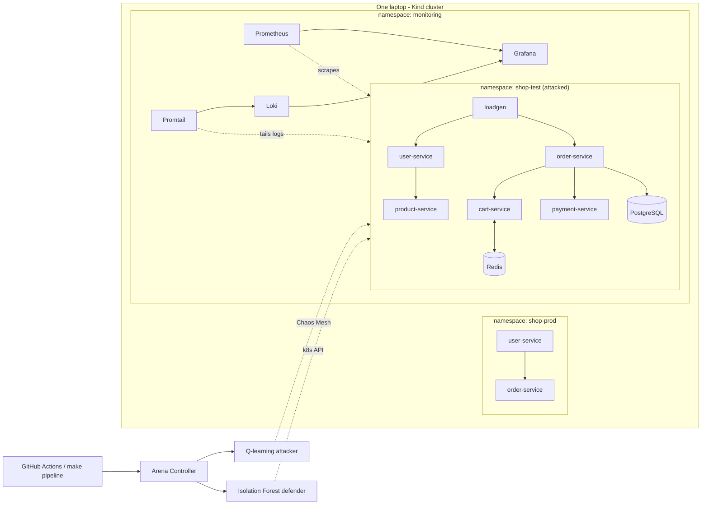

# ChaosArena

[](https://github.com/atharvvv10/chaosarena/actions/workflows/ci.yml)

**A resilience-gated CI/CD lab that treats a release like a fight.** A local attacker injects one of seven allowlisted Chaos Mesh faults into a `shop-test` namespace; an Isolation Forest defender detects, diagnoses and requests a repair; and a controller scores the whole exchange into a `PROMOTE`/`BLOCK` decision. It all runs on one laptop with Kind, Prometheus, Grafana and a React dashboard — no cloud account, paid CI minute or hosted database. The default path needs **no API key**; v1.2 can optionally use free Groq/Gemini keys for advisory reasoning and report prose. The repo ships the tests, saved battle evidence, free GitHub Actions workflow and a recorded demo, so you can see and verify the full loop rather than trust a diagram.


[Watch the dashboard walkthrough (MP4)](docs/screenshots/demo.mp4) · [Dashboard screenshot](docs/screenshots/dashboard.png) · [Grafana screenshot](docs/screenshots/grafana.png) · [All results](docs/RESULTS.md)

## Evaluate ChaosArena

Choose the level of depth that fits your time.

**Option 1: Quick technical demonstration**

```powershell
.\.venv\Scripts\python.exe scripts/technical_demo.py
```

No running Kubernetes cluster required. The replay reads committed evidence and a real audit artifact, then recomputes the release decision with the project's own gate code. This demonstrates that stored verdicts are not trusted — not that the underlying measurements themselves cannot be altered. [Read the generated transcript](docs/DEMO_TRANSCRIPT.md).

**Option 2: Inspect the dashboard**

Start the existing FastAPI backend and React frontend using the documented setup in [DEMO_RUNBOOK.md](docs/DEMO_RUNBOOK.md#1-deterministic-demo-from-committed-evidence). No live battle is needed to see the published results.

**Option 3: Reproduce a live experiment**

Follow [DEMO_RUNBOOK.md](docs/DEMO_RUNBOOK.md) to run a controlled battle in the isolated Kind environment. [DEMO_AUDIT.md](docs/DEMO_AUDIT.md) records the last real run and its environmental limitations.

The GIF and MP4 are a walkthrough of the committed 100/A battle evidence, the bad-release/rollback panel and the offline benchmark panels; they predate the v1.2 **AI Reasoning** panel. The dashboard PNG is a full-page capture at 1440×4981. The Grafana PNG remains the real capture from the audited live Kind run. The v1.2 live battle and its AI advisory evidence are documented in [V12_LIVE_VALIDATION.md](docs/V12_LIVE_VALIDATION.md); no v1.1 evidence or media was overwritten.

## What v1.2 adds

v1.2 is an **additive AIML upgrade** on top of the frozen v1.1 evidence:

- **DQN attacker** with replay buffer and target network, alongside the original tabular Q-learning baseline.
- **LSTM-autoencoder defender** alongside the shipped Isolation Forest.
- **Role-scoped LLM reasoning**: Groq proposes an allowlisted attack idea and writes the incident report; Gemini explains defender findings. Local RL/detector code and the classical release gate still own the real control loop.
- **Dashboard AI Reasoning panel** showing recorded source, latency, rationale and recommendation — never API keys.
- **Offline by default**: no key is needed for tests, CI or the normal template reporter. Only `python -m scripts.llm_live_check` and the optional live-lab runner use free-tier keys from a gitignored `.env`.

Full details: [ARCHITECTURE_AIML.md](docs/ARCHITECTURE_AIML.md) and [V12_LIVE_VALIDATION.md](docs/V12_LIVE_VALIDATION.md).

## Results at a glance

| What | Measured result |
| --- | --- |
| Automated tests | **164 passing**: phase suites, AIML suites, live-evidence checks and regression checks (`make verify`) |
| Chaos attacks | **7** allowlisted faults, `shop-test` only, cleanup verified in recorded runs; 0 residual chaos objects |
| Headline gated battle | **100/100, grade A, PROMOTE** at threshold 70; `network-latency` detected in **13.3 s**, recovered in **76.2 s**, cleanup ok, 0 objects left |
| Defender | Detected in **13.3 s**, recovered in **76.2 s**; diagnosed `latency_spike` on `order-service` (symptomatic, not necessarily the origin); 40-sample baseline (threshold 0.7397) |
| Gate vs bad release | A deliberately bad payment config (`PAYMENT_FAILURE_RATE=1.0`) scored **65/D, BLOCK**; rollback to `0.01` scored **100/A, PROMOTE** on the same battle |
| RL attacker | Learned policy does **more damage than random**: **1.77×** (resilience **70.0** vs **83.1**) in the seeded simulator |
| Detector comparison | Plain Isolation Forest **0% recall**; full Defender **76% recall at 0% false positives** — [details](#detector-comparison) |
| v1.1 validation | **10 paired live trials, 0/30 false alarms on held-out data**; primary sign test p = 0.109 (not conclusive) — [report](docs/EXPERIMENTAL_VALIDATION.md) |
| v1.2 AIML validation | DQN beat tabular in **30/30** seeded episodes (exact sign test p ≈ 2e-09); LSTM detected **30/30** seeded spikes with **3/30** false alarms — [architecture](docs/ARCHITECTURE_AIML.md) |
| v1.2 live lab battle | `pod-kill@order-service` detected in **15.8 s**, score **100/A/PROMOTE**, cleanup ok, 0 chaos objects left — [evidence](docs/V12_LIVE_VALIDATION.md) |
| AI reasoning | Groq attack idea + incident report, Gemini defence analysis, visible in the dashboard **AI Reasoning** panel; no key values stored |
| CI | Free `ubuntu-latest` Actions, latest push green, no cluster, no secrets required |
| Cost | **$0** — local Kind, free React/Vite, free Actions tier, offline reporter by default |

## Learned vs random attacker

A Q-table is only useful if it finds worse attacks than chance. In the seeded
offline simulator (200 episodes, seed 7, per-fault effectiveness taken from
recorded Phase 3/4 battles):

| Policy | Avg damage (0–100) | Avg resilience score |
| --- | --- | --- |
| Uniform random | 16.9 | 83.1 |
| **Learned Q-learning** | **30.0** | **70.0** |

The learned attacker converges on `network-partition@payment-service` and does
**more damage than random** — 1.77× as much, measured as points taken off the
resilience score. This is a reproducible offline benchmark, **not** a live
cluster battle. Evidence: `ml/rl_benchmark.json`; regenerate with
`python -m rl.cli benchmark`.

## Detector comparison

Same labelled data for all three: the committed 40-sample normal baseline plus
160 seeded fault signatures (latency spike, error spike, traffic drop, and a
subtle multi-service latency rise). Offline and reproducible — evidence in
`ml/defender_benchmark.json`; regenerate with `python -m defender.cli benchmark`.

| Detector | Precision | Recall | False positives |
| --- | --- | --- | --- |
| Rule-based (3-sigma) | 99.4% | **100%** | 1 / 40 normal |
| Isolation Forest only | n/a | 0% | 0 / 40 normal |
| **Defender (forest + capped deviation)** | **100%** | 76.2% | **0 / 40 normal** |

Read this honestly: a simple 3-sigma rule catches every seeded spike but raises
a false alarm on normal traffic. A plain Isolation Forest catches **none** —
across 18 features it dilutes a single-service spike until it looks normal. The
shipped Defender adds a bounded standardized-deviation term that lifts recall
from 0% to 76% while keeping **zero false positives**; the remaining misses are
small error-rate spikes. Zero false positives is the right trade for a release
gate, where a false alarm blocks a good build.

## What is in the loop

1. **Attacker** — seven Chaos Mesh experiments behind a hard `shop-test` allowlist; `finally` cleanup always runs.
2. **Defender** — reads only Prometheus signals, uses Isolation Forest plus a capped deviation term, then detect → diagnose → request a repair → verify. It requests the action; it does not repair by itself. It never imports or reads the attacker.
3. **Controller** — drives both sides through their public CLIs, recomputes the resilience score from observed facts, and records the gate decision and audit trail.
4. **Dashboard + CI** — a local React UI with a section nav, always-visible key results, a real battle timeline, labelled offline benchmark panels, an **AI Reasoning** panel, searchable history and report actions, plus a free GitHub workflow that re-scores saved fixtures on every push. See [DASHBOARD.md](docs/DASHBOARD.md).

## Honest scope — read this before an interview

### Proven by committed evidence

- The headline battle scored **100/A/PROMOTE**; the bad-release pair scored **65/D/BLOCK**, then **100/A/PROMOTE** after the experiment script rolled the config back. [Full results](docs/RESULTS.md).
- CI re-scores **saved** fixtures on a free, cluster-free runner and is green. It does **not** run a live battle; the real battles were local and their evidence is committed.
- Offline seeded benchmarks show the attacker beats random and the Defender beats a plain Isolation Forest. They are benchmarks, not live battles.
- v1.1 adds **10 paired live trials** and **0/30 held-out false alarms**. The primary sign test is not conclusive. [Full study](docs/EXPERIMENTAL_VALIDATION.md).
- v1.2 AI APIs are **advisory and reporting only**. They never call `kubectl`, create Chaos Mesh objects or decide the gate; the allowlisted CLIs and classical defender own the real loop.
- The early Phase 4 **65/BLOCK** was a *measurement timing* issue, not a caught bad release. [Details](docs/RESULTS.md).

### Not proven / do not overclaim

- The attacker is **tabular Q-learning, not PPO**. The baseline is 40 samples and the detector benchmark is in-sample and synthetic. [Build notes](docs/BUILD_NOTES.md).
- Diagnosis is symptomatic: the headline fault hit `payment-service`, but `order-service` was restarted.
- The Defender did **not** improve recovery in the headline network-latency control: **76.2 s** with a requested restart versus **50.8 s** without one. [Control run](docs/RESULTS.md#no-defender-control-run).
- In v1.1 all observe-only trials also recovered. The tight ~124 s cluster in the enabled group may reflect a **measurement floor**, and that run did not record which pod was stressed or whether the restart replaced it.
- The release gate is not a hard must-detect gate. In experimental trial 07, the detector missed the fault, yet the release received PROMOTE because the score met the configured threshold.
- **100/A** is not a speed claim; `recovery_seconds` includes observation lag and the gate does not penalise slow recovery.
- The 30 holdout windows came from one steady load session, so the **9.5%** false-positive upper bound is optimistic.

## Try it in the dashboard

```text
http://127.0.0.1:5173     dashboard
http://127.0.0.1:8080     gate API
```

1. Click **Refresh** — the header distinguishes `API ONLINE · LAB READY` from `API ONLINE · LAB NOT READY`. The API can be reachable while Kind or Prometheus is unavailable; a live battle needs the lab ready.
2. In **Run a battle**, use: attack `network-latency`, target `payment-service`, duration `30`, settle `45`, threshold `70`, version `release-candidate`.
3. Click **Run battle** and wait about a minute. Do not click twice.
4. Read the **Release gate** card for score/grade/verdict and **Why**. A new row appears in **Decision history**.
5. Check **RL attacker** for the learned policy. In **Incident report**, use **Copy** or **Download**.
6. Use the sidebar navigation to open **Evidence**: the timeline is the recorded real battle; **Learned vs random** and **Detector comparison** are clearly labelled offline benchmarks. In **History**, search or filter PROMOTE/BLOCK rows.
7. Open **AI Reasoning** to see Groq's recorded attack idea, Gemini's defence reading, the local DQN top idea and the report backend. These are read from `ml/deep/live/`; no API keys are displayed.

If the API is offline, start it with `python -m uvicorn controller.api:app --host 127.0.0.1 --port 8080` from the project venv. If the API is online but the lab is not ready, start Kind, deploy the lab and open the Prometheus port-forward described below; the dashboard can still read committed evidence. If the dashboard is closed, run `cd dashboard && npm run dev`.

For a technical evaluator, [DEMO_RUNBOOK.md](docs/DEMO_RUNBOOK.md) gives the exact
committed-state and live-battle commands, and [DEMO_AUDIT.md](docs/DEMO_AUDIT.md)
records what was actually verified in the isolated Kind environment, including
environmental limitations. A live battle requires the Prometheus port-forward
(`kubectl -n monitoring port-forward svc/prometheus 9090:9090`); the dashboard
alone only reads committed evidence unless a live battle is run.

## Fresh clone

```bash
make cluster     # Kind cluster with shop-test, shop-prod, monitoring
make deploy      # build and load 6 images, apply manifests
make metrics     # REQUIRED before a live battle: Prometheus on :9090
make gate-api    # local gate API on :8080
cd dashboard && npm install && npm run dev
make verify      # all cluster-free checks: tests, guards, gate fixtures, UI build
```

`make metrics` blocks, so run it in its own terminal. On Windows, use the
PowerShell equivalents in [local-setup.md](docs/local-setup.md); the `make`
targets call `chmod` and shell scripts. Plain-Python and Docker Compose
alternatives are in [BUILD_NOTES.md](docs/BUILD_NOTES.md).

## Architecture



## Documentation

- [Final results](docs/RESULTS.md) · [Testing guide](docs/TESTING.md) · [Build notes](docs/BUILD_NOTES.md) · [Portfolio polish](docs/PORTFOLIO_POLISH.md)
- [Phase 1 ShopApp](docs/phase1.md) · [Phase 2 attacks](docs/phase2.md) · [Phase 3 defender](docs/phase3.md) · [Phase 4 controller](docs/phase4.md) · [Phase 5 reporter](docs/phase5.md)
- [Phase 6 CI](docs/phase6.md) · [Phase 7 dashboard](docs/phase7.md) · [Phase 8 RL attacker](docs/phase8.md) · [Phase 9 polish](docs/phase9.md)
- [Dashboard README](dashboard/README.md) · [Dashboard UI and evidence panels](docs/DASHBOARD.md)

Everything here is free and local. No paid service, no cloud account, no secret and no marketplace action is required.
