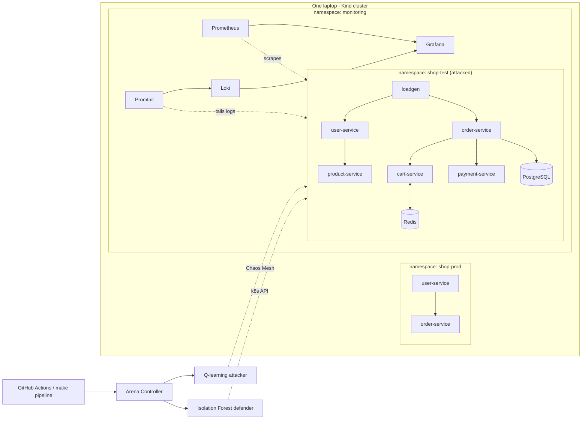

# ChaosArena

[](https://github.com/atharvvv10/chaosarena/actions/workflows/ci.yml)

**A resilience-gated CI/CD lab that treats a release like a fight.** A tabular Q-learning attacker injects one of seven allowlisted Chaos Mesh faults into a `shop-test` namespace; an Isolation Forest defender detects, diagnoses and repairs the fault; and a controller scores the whole exchange into a `PROMOTE`/`BLOCK` decision. It all runs on one laptop with Kind, Prometheus, Grafana and a React dashboard — no cloud account, paid CI minute, hosted database or API key. The repo ships the tests, saved battle evidence, free GitHub Actions workflow and a recorded demo, so you can see and verify the full loop rather than trust a diagram.


[Watch the full demo (MP4)](docs/screenshots/demo.mp4) · [Dashboard screenshot](docs/screenshots/dashboard.png) · [Grafana screenshot](docs/screenshots/grafana.png) · [All results](docs/RESULTS.md)

## Results at a glance

| What | Measured result |
| --- | --- |
| Automated tests | **110 passing** across all 9 phases (`make verify`) |
| Chaos attacks | **7** allowlisted faults, `shop-test` only, guaranteed cleanup — **0 objects left** |
| Live gated battle | **70/100, grade C, PROMOTE** at threshold 70; not detected but recovered, cleanup ok, 0 objects left |
| Defender | 40-sample baseline (threshold 0.7397); Phase 3/4 latency attacks were diagnosed and recovered |
| RL attacker | Tabular Q-learning, **200** simulated episodes, learned Q ≈ **1.50** |
| CI | Free `ubuntu-latest` Actions, green on every push, no cluster, no secrets |
| Cost | **$0** — local Kind, free React/Vite, free Actions tier, offline reporter by default |

## What is in the loop

1. **Attacker** — seven Chaos Mesh experiments behind a hard `shop-test` allowlist; `finally` cleanup always runs.
2. **Defender** — reads only Prometheus signals, uses Isolation Forest plus a capped deviation term, then detect → diagnose → act → verify. It never imports or reads the attacker.
3. **Controller** — drives both sides through their public CLIs, recomputes the resilience score from observed facts, and records the gate decision and audit trail.
4. **Dashboard + CI** — a local React UI for running battles and reading history/policy, plus a free GitHub workflow that re-scores saved fixtures on every push.

## Honest scope — read this before an interview

- The early **score 65 / BLOCK** was a *measurement timing* issue: the final Prometheus sample was still inside the attack window. A bounded settle period fixed the measurement; it was **not** a bad release being caught.
- GitHub Actions does **not** run a live battle. It re-scores **saved** passing and failing JSON fixtures on a cluster-free runner. The real battles were run locally and their evidence is committed.
- The attacker is **tabular Q-learning** (a JSON Q-table with epsilon-greedy exploration), **not PPO** or a deep RL model.
- The Defender baseline is **40 samples**. That is enough for a deterministic local demo with steady synthetic load; production would need days of traffic across peak/off-peak cycles, drift detection and held-out incidents. See [BUILD_NOTES.md](docs/BUILD_NOTES.md).

## Try it in the dashboard

```text
http://127.0.0.1:5173     dashboard
http://127.0.0.1:8080     gate API
```

1. Click **Refresh** — expect `API online`.
2. In **Run a battle**, use: attack `network-partition`, target `payment-service`, duration `10`, settle `20`, threshold `70`, version `demo-v1`.
3. Click **Run battle** and wait about a minute. Do not click twice.
4. Read the **Release gate** card for score/grade/verdict and **Why**. A new row appears in **Decision history**.
5. Check **RL attacker** for the learned policy and **Incident report** for the generated report.

If the API is offline, start it with `python -m uvicorn controller.api:app --host 127.0.0.1 --port 8080` from the project venv. If the dashboard is closed, run `cd dashboard && npm run dev`.

## Fresh clone

```bash
make cluster     # Kind cluster with shop-test, shop-prod, monitoring
make deploy      # build and load 6 images, apply manifests
make gate-api    # local gate API on :8080
cd dashboard && npm install && npm run dev
make verify      # all cluster-free checks: tests, guards, gate fixtures, UI build
```

Plain-Python and Docker Compose alternatives are in [BUILD_NOTES.md](docs/BUILD_NOTES.md).

## Architecture



## Documentation

- [Final results](docs/RESULTS.md) · [Testing guide](docs/TESTING.md) · [Build notes](docs/BUILD_NOTES.md) · [Portfolio polish](docs/PORTFOLIO_POLISH.md)
- [Phase 1 ShopApp](docs/phase1.md) · [Phase 2 attacks](docs/phase2.md) · [Phase 3 defender](docs/phase3.md) · [Phase 4 controller](docs/phase4.md) · [Phase 5 reporter](docs/phase5.md)
- [Phase 6 CI](docs/phase6.md) · [Phase 7 dashboard](docs/phase7.md) · [Phase 8 RL attacker](docs/phase8.md) · [Phase 9 polish](docs/phase9.md)
- [Dashboard README](dashboard/README.md)

Everything here is free and local. No paid service, no cloud account, no secret and no marketplace action is required.
